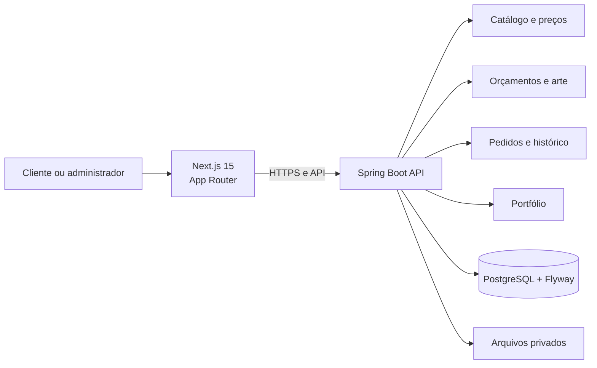

# Arquitetura BRINDESPRO

## Módulos

| Área | Responsabilidade |
| --- | --- |
| `frontend/src/app` | Rotas públicas e administrativas. |
| `frontend/src/components` | Header, footer, cards e elementos reutilizáveis. |
| `frontend/src/lib` | Cliente HTTP, tipos, cache e estado do orçamento. |
| `catalog` | Produtos, categorias, variações e preço. |
| `quote` | Orçamentos, clientes e artes. |
| `order` | Pedidos, status, rastreio e notificações. |
| `portfolio` | Projetos e depoimentos demonstrativos. |
| `security` | Sessão, CSRF e CORS. |

## Segurança atual

- Rotas `/api/admin/**` exigem autenticação.
- Pedido público exige número e e-mail correspondentes.
- Artes ficam fora da pasta pública.
- Banco usa Flyway e `ddl-auto=validate`.
- Variáveis são documentadas em `.env.example`.

## Próximos passos

1. Storage externo para imagens públicas.
2. Fila para notificações após configurar provedores.
3. Testes no CI contra PostgreSQL real.
4. Rate limit para login e consulta de pedidos.
