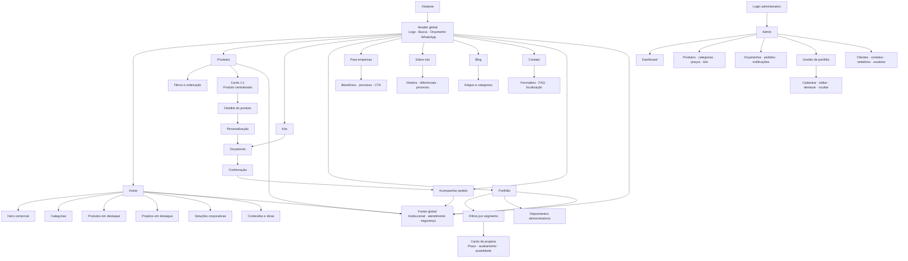
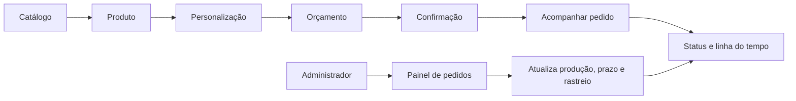

# Design System — BRINDESPRO

## Mapa visual atual

### Fluxo visual de compra e atendimento

## Objetivo

O BRINDESPRO é um case demonstrativo de e-commerce B2B de brindes personalizados. A interface deve comunicar confiança, organização e praticidade, sem citar clientes ou marcas reais.

## Diagnóstico visual

| Área | Estado | Diagnóstico |
| --- | --- | --- |
| Identidade visual | Bom | Azul, laranja e verde já criam reconhecimento consistente. |
| Container e responsividade | Bom | O container global usa 1200px, 32px no desktop e 16px em telas menores. |
| Fotografias de produtos | Precisa melhorar | A regra global deve permanecer em `object-fit: contain`; imagens editoriais podem usar `cover` em containers com proporção definida. |
| Páginas internas | Bom | `PageHero` centraliza a estrutura e mantém hero compacto. |
| Cards | Precisa melhorar | Existem estilos locais distintos. Novos cards devem adotar raio de 8px a 14px, borda discreta e espaçamento de 16px. |
| Header em larguras intermediárias | Precisa melhorar | Deve ser revisado sempre que links forem incluídos, para evitar compressão próxima de 1024px. |
| Admin | Precisa melhorar | Tabelas e modais funcionam, mas precisam compartilhar o mesmo conjunto de badges, estados vazios e espaçamento. |
| Acessibilidade | Precisa melhorar | Botões de ícone devem manter `aria-label`; filtros devem sempre informar o estado selecionado. |

## Tokens

### Cores

- Azul-marinho: `#102650`
- Laranja: `#FF642F`
- Verde WhatsApp: `#159947`
- Fundo: `#F4F6F9`
- Superfície: `#FFFFFF`
- Texto secundário: `#60708A`
- Linha: `#E1E7EF`

### Tipografia

Fonte: **Manrope**.

| Uso | Tamanho desktop | Uso |
| --- | ---: | --- |
| H1 | 36px | Hero e páginas principais |
| H2 | 28px | Seções principais |
| H3 | 16px–18px | Cards e blocos |
| Texto | 13px–14px | Conteúdo geral |
| Label e tabela | 11px–12px | Campos, filtros e metadados |

### Espaçamento

`4, 8, 12, 16, 24, 32, 48 e 64px`.

## Regras de layout

- Largura máxima: `1200px`.
- Desktop: `32px` de padding horizontal.
- Mobile: `16px` de padding horizontal.
- Hero interno: 260px a 280px no desktop; conteúdo legível sobre fotografia horizontal.
- Cards: fundo branco, borda discreta, raio de 8px a 14px e sombra mínima.
- Ações principais: laranja; ações de WhatsApp: verde; ações administrativas: azul-marinho.

## Diretrizes de imagem

- Produtos: contêiner 1:1 e `object-fit: contain`.
- Blog: 16:9.
- Institucional e banners: 4:3 ou 16:9, somente com `cover` após conferir o enquadramento.
- Não utilizar screenshot como asset de produto.
- Produtos devem aparecer inteiros, com margem interna e fundo independente da imagem.

## Componentes

- `SiteHeader` e `SiteFooter`: únicos em todas as páginas públicas.
- `PageHero`: padrão para Sobre, Blog, Contato, Portfólio e Para empresas.
- `.panel`: base para cards, tabelas, formulários e modais.
- `.btn`: altura mínima de 40px e foco visível.
- `.input`, `.select`, `.textarea`: altura e raio uniformes.

## Responsividade

| Largura | Regra |
| --- | --- |
| 1440px | Grid completo e container máximo de 1200px. |
| 1024px | Reduzir lacunas do header e manter cards em 2 ou 3 colunas conforme conteúdo. |
| 768px | Menu móvel, grids em 2 colunas e tabelas com rolagem horizontal. |
| 390px / 360px | Uma coluna para cards de conteúdo, botões com área de toque mínima de 42px. |

## Prioridades de implementação

1. Unificar tokens, botões, campos e superfícies.
2. Garantir `contain` em imagens de produto e revisar cada hero.
3. Consolidar padrões de card e tabela do admin.
4. Validar header, filtros, modais e tabelas em 1024px, 768px, 390px e 360px.
5. Criar estados vazios e mensagens de erro consistentes para todo o painel.
