# Diagramas completos — BRINDESPRO

Este documento representa a arquitetura e os fluxos atuais do projeto demonstrativo BRINDESPRO. Os dados de empresas, projetos e depoimentos são demonstrativos.

## 1. Visão geral da plataforma

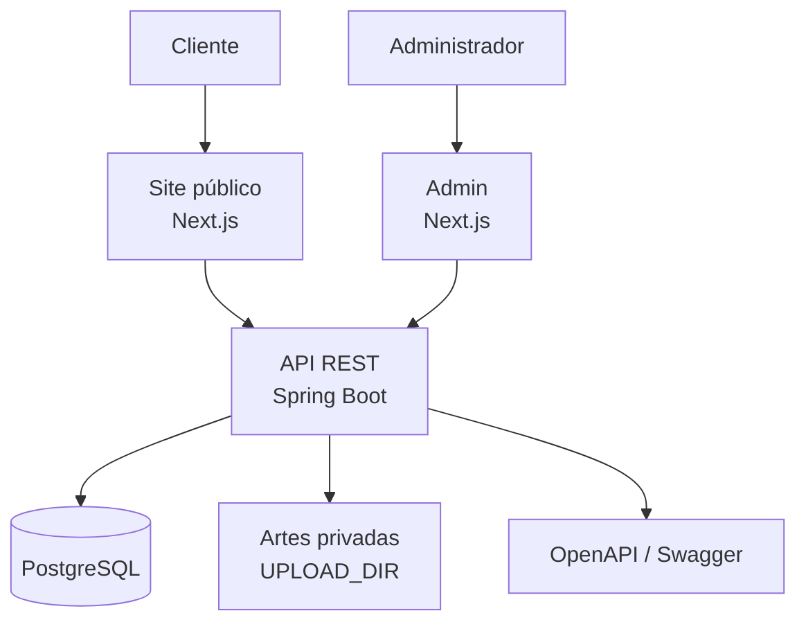

## 2. Mapa das páginas públicas

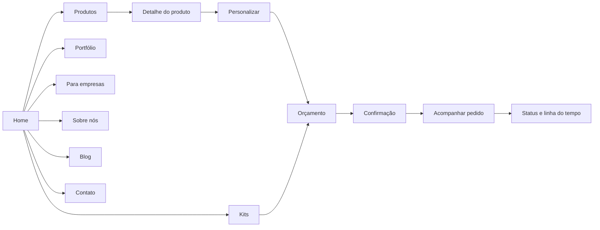

## 3. Fluxo principal do cliente

```mermaid
flowchart LR
  A[Catálogo] --> B[Seleciona produto]
  B --> C[Escolhe variante, quantidade e gravação]
  C --> D[Envia arte e prévia]
  D --> E[Adiciona ao orçamento]
  E --> F[Preenche dados de contato]
  F --> G[Pedido é registrado]
  G --> H[Recebe número público]
  H --> I[Acompanha com número + e-mail]
  I --> J[Status, itens, prazo e rastreio]
```

## 4. Fluxo de pedidos e atualização administrativa

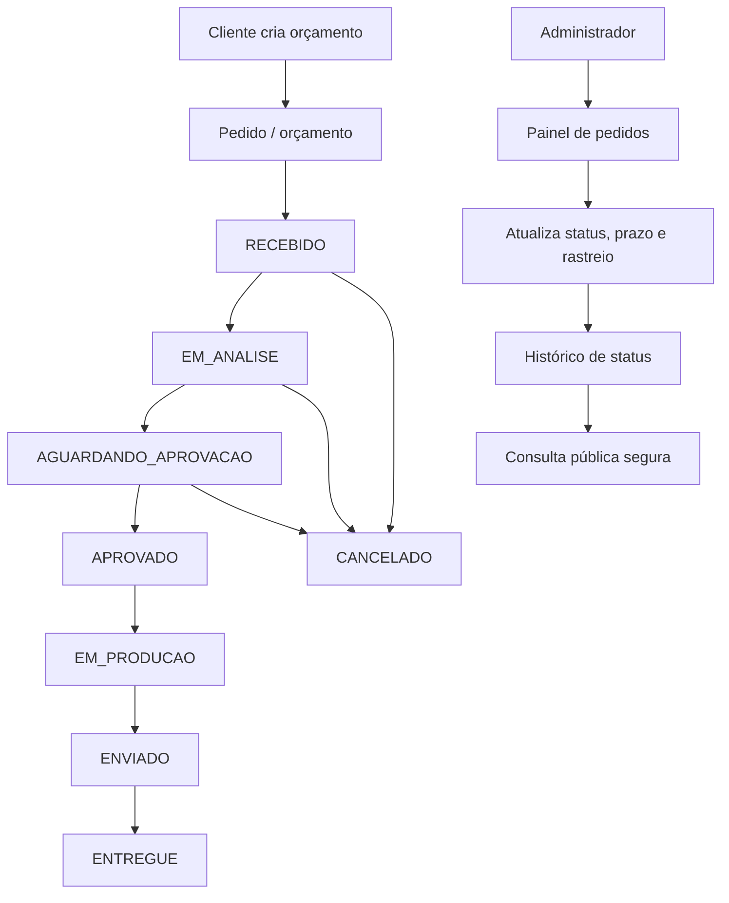

## 5. Linha do tempo pública

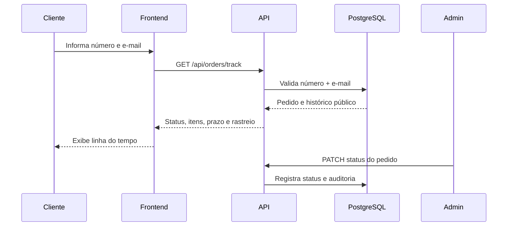

## 6. Painel administrativo

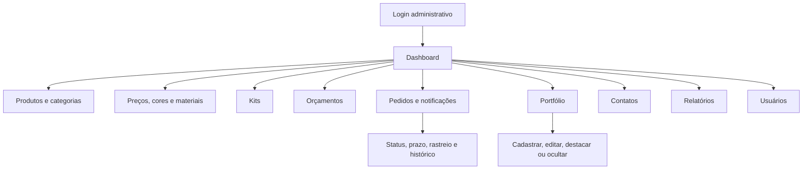

## 7. Fluxo de autenticação administrativa

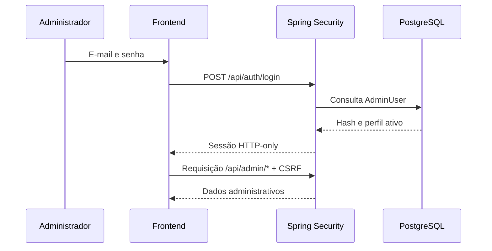

## 8. Módulos da API

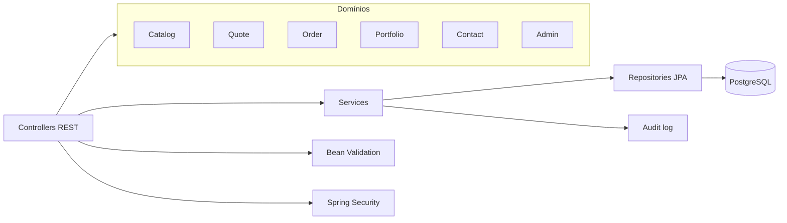

## 9. Modelo de dados principal

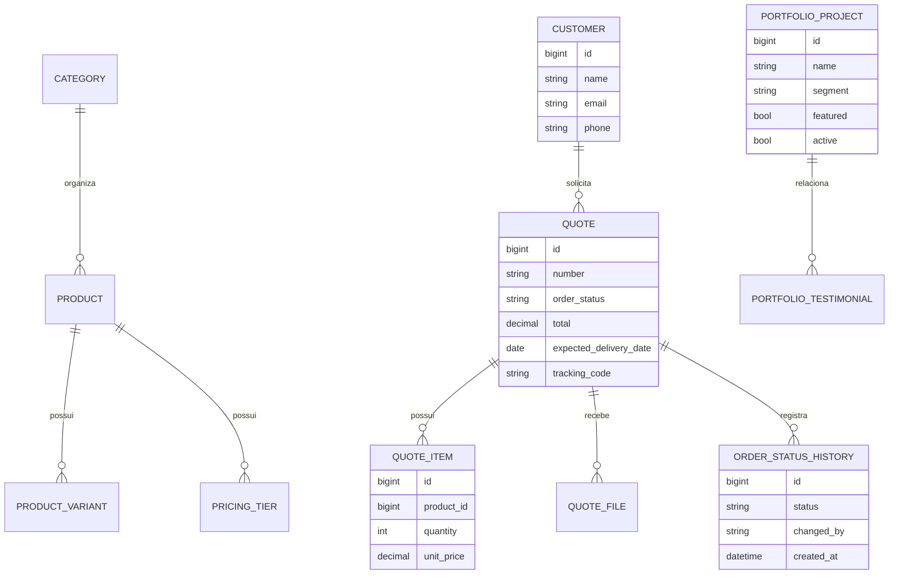

## 10. Upload de arte

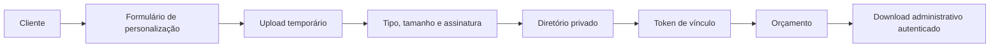

## 11. Portfólio demonstrativo

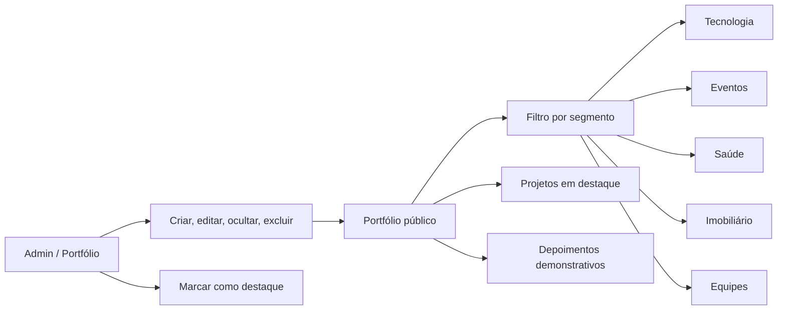

## 12. Segurança e fronteiras de acesso

```mermaid
flowchart TB
  Public[Internet] --> PublicRoutes[Rotas públicas]
  PublicRoutes --> Track[Tracking exige número + e-mail]
  Public --> Login[Login admin]
  Login --> Session[Sessão HTTP-only + CSRF]
  Session --> AdminRoutes[/api/admin/*]
  AdminRoutes --> ProtectedData[Pedidos, portfólio, configurações]
  Uploads[Artes privadas] --> AdminOnly[Acesso administrativo]
```

## 13. Deploy recomendado

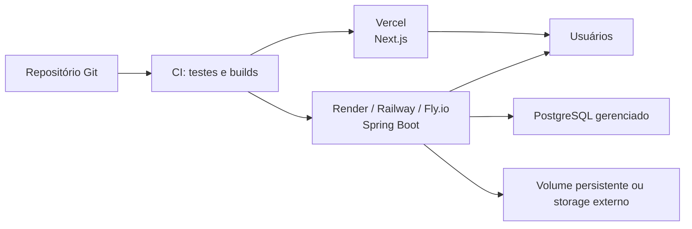

## 14. Estados de interface

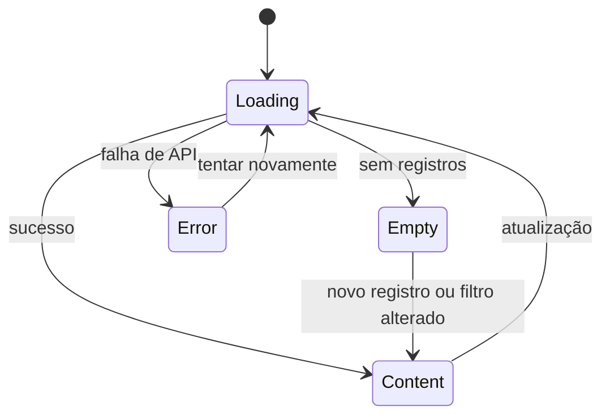

## 15. Resumo de responsabilidade

| Parte | Responsabilidade |
| --- | --- |
| Next.js | Navegação, interface, estado de orçamento e consumo da API. |
| Spring Boot | Regras de negócio, segurança, validação e API REST. |
| PostgreSQL | Dados persistentes, pedidos, catálogo, portfólio e auditoria. |
| Flyway | Evolução versionada do banco. |
| Upload privado | Artes enviadas pelo cliente, acessíveis ao atendimento administrativo. |
| Admin | Gestão do catálogo, pedidos, portfólio, contatos e relatórios. |
